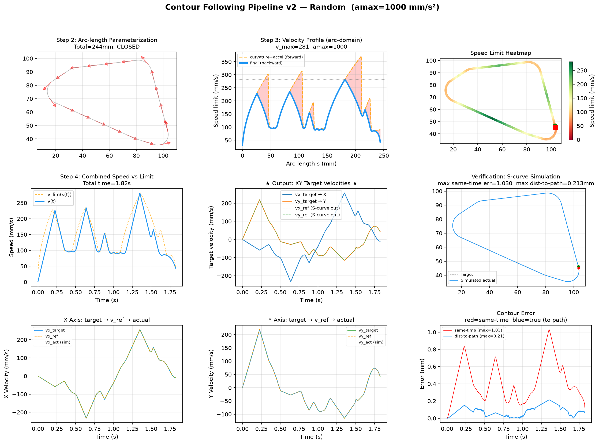
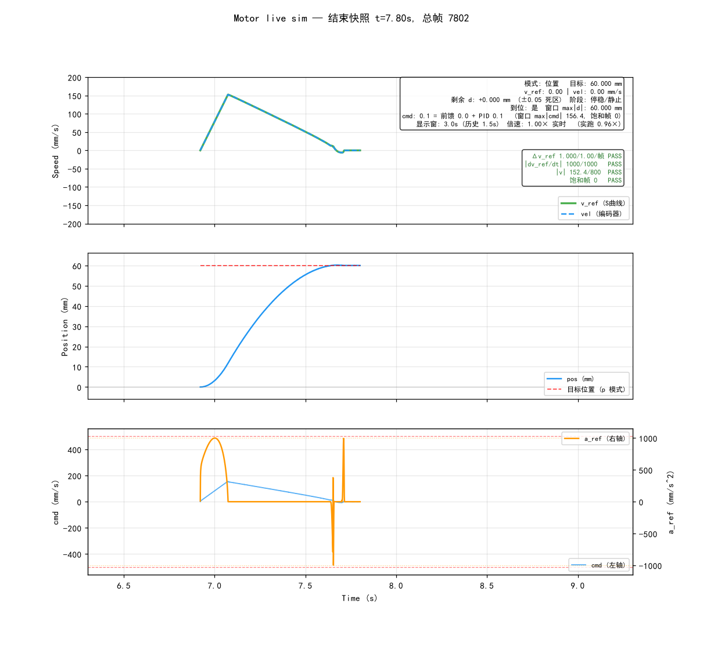

# XY 轮廓跟随 · 单轴 S 曲线运动控制

纯 Python 的运动控制实现，四件套：

**单轴 S 曲线控制器**（速度 / 位置 / 力矩三种输入） + **XY 轮廓跟随规划器** + **实时可视化仿真** + **全量验证套件**。

不绑定任何硬件或框架 —— 控制器每 `dt` 调用一次 `update()`，把返回的 `cmd` 送给驱动器即可；双轴轮廓跟随时每轴一个实例，多轴同理。

---

## 特性

- **七次多项式 S 曲线**：任意目标（含突变、反向、中途改目标）都平滑过渡，速度连续、起停 jerk 为 0，无阶跃冲击。
- **硬约束逐帧可验证**：任何工况下 `|Δv_ref| ≤ amax·dt`、`|a_ref| ≤ amax`、`|v_ref| ≤ v_max`。不是"通常满足"，而是测试与实时仿真里逐帧 PASS/FAIL 校验的指标。
- **三种输入同构**：速度 / 位置 / 力矩共用同一个 S 曲线状态机，也共用同一个 `mc` 实例，随时切换通道。
- **位置控制第一次就到位**：减速曲线直接挂在实测位移上，电机跟踪滞后和负载扰动不影响终点，无"表走完未到位"的兜底重规划，无二次加速尖峰。
- **抗编码器噪声**：死区 + 迟滞锁存 + 目标速度低通，停位区不出现 `0 ↔ ±v` 高频翻转。
- **自带逼真电机模型**：静摩擦 (stick-slip) / 库仑 + 粘滞摩擦 / 编码器量化 + 白噪声 / 执行器饱和 / 硬件限速 / 加速度硬限 / 阶跃负载扰动。
- **全量验证套件**：8 组测试，固定随机种子可复现，全部 PASS 退出码 0。

---

## 效果预览

**XY 轮廓跟随**（`python planner.py --seed 1` 的实际输出，真轮廓误差 max 0.213mm / mean 0.083mm）：



**实时仿真**（`python motor.py`，位置模式 `p 60` 的快照）：上格速度 S 曲线爬升后收尾，中格位置收敛并贴住目标线，下格 `cmd` 与 `a_ref`，右侧绿字为实时硬约束校验。



---

## 文件

| 文件 | 作用 |
|---|---|
| `motor_controller.py` | **核心库**：`MotorController`（速度）+ `Moveposition`（位置）+ `TorqueControl`（力矩）+ `SimulatedMotor`（仿真电机）。含自测 `python motor_controller.py` |
| `motor.py` | **交互式实时仿真**：命令行下指令，1ms/帧仿真 + 三面板滚动示波器 + 实时硬约束校验 |
| `planner.py` | **轮廓规划器**：轮廓点序列 → 1ms/帧 `vx/vy` 目标速度序列 → 双轴闭环跟随仿真 + 出图 + 误差统计 |
| `test_motor_controller.py` | **全量验证套件**：8 组测试（含随机加压与 CLI 冒烟），约 2 分钟 |
| `startpy.bat` | Windows 便捷启动器（改 `SCRIPT_NAME` 选要跑的文件） |
| `docs/` | README 配图（`planner.py` / `motor.py` 的真实运行输出） |

依赖：Python 3.8+、`numpy`、`matplotlib`。

```bash
pip install numpy matplotlib
```

> 只有 `planner.py` / `motor.py` / 测试套件需要 numpy 和 matplotlib；`motor_controller.py` 的库部分只用标准库。

---

## 快速开始

```bash
python motor_controller.py        # 控制器自测 + 出图 motor_controller_sim.png，成功打印 All tests passed!
python test_motor_controller.py   # 全量验证套件（约 2 分钟，全部 PASS 退出码 0）
python motor.py                   # 交互式实时仿真（命令行下指令，实时校验 + 示波器窗口）
python planner.py                 # 轮廓跟随完整链路仿真 → pipeline_Random.png
```

Windows 控制台中文乱码时，前面加 `PYTHONIOENCODING=utf-8`。

---

## 1. MotorController — 速度控制

```python
from motor_controller import MotorController

mc = MotorController(kp=0.5, ki=0.02, kd=0.01, dt=0.001, amax=1000, v_max=500.0)

# 每个控制周期（dt）调用一次：
v_ref, cmd = mc.update(target_speed=100.0, actual_velocity=98.3)  # 有编码器 → 闭环（S曲线 + 前馈 + PID）
v_ref, cmd = mc.update(target_speed=100.0)                        # 无编码器 → 开环（S曲线 + 前馈）

mc.reset()   # 换目标 / 急停后复位内部状态
```

- `target_speed`：目标速度（mm/s 或任意单位，与返回值同单位），超出 `±v_max` 会被钳制
- `actual_velocity`：编码器实测速度（同单位），可选；不传则开环，内部用 S 曲线自身的 `v_ref` 作为速度估计
- 返回 `v_ref`：S 曲线平滑后的参考速度；`cmd`：电机控制量（前馈 + PID，限幅在 `out_max` 内）

### 构造参数

```
kp, ki, kd   : PID 增益
dt           : 控制周期 (s)      ← 必须与你的控制循环周期一致
amax         : 最大加速度 (mm/s²) ← 硬约束，任何工况单帧变化 ≤ amax·dt
i_max        : 积分限幅 (默认 1.0)
out_max      : PID 输出限幅 (默认 1.0)
kff_vel      : 速度前馈系数 (默认 1.0)
kff_acc      : 加速度前馈系数 (默认 0.0，已知电机时间常数后可开)
smooth_tau   : 输出一阶低通时间常数 (s，默认 0 = 关闭；指令太顿再打开)
v_max        : 速度上限 (mm/s，默认 500.0)；位置控制匀速速度 = 0.85·v_max
```

### S 曲线

- 归一化曲线 `h(τ) = 35τ⁴ − 84τ⁵ + 70τ⁶ − 20τ⁷`，`h(0)=0, h(1)=1`，一阶、二阶导数在两端均为 0
- 单次速度变化耗时 `T = 2.1875·|ΔV|/amax`，单程刹停距离 `1.09375·V²/amax`
- 目标随时可切换：换目标瞬间以速度连续优先续接曲线（目标变化率 ≤ amax·dt 时平滑跟进，跳变时以 amax 追近），不等待、不重启、不丢帧

---

## 2. Moveposition — 位置控制

控制器本身是纯速度控制。要按位置走，用这个薄应用层：每帧从**实测位移**重算目标速度，内部复用 `mc.update()`，控制器代码一行不改。

```python
from motor_controller import MotorController, Moveposition

mc = MotorController(kp=0.5, ki=0.02, kd=0.01, dt=0.001, amax=1000, v_max=300.0)
mp = Moveposition(mc)                    # 位置应用层（复用 mc.update）

# 每个控制周期调用一次：
v_ref, cmd = mp(target_pos, pos)         # 输入目标位置 (mm)，返回同上
pos, vel = motor.step(cmd, dt)           # 编码器读数
if mp._arrived:                          # 到位并停稳后可查询
    ...
```

> ⚠️ 位置模式下**必须直接用 `mp()` 的返回值**，不要再调 `mc.update()` —— `mp` 内部已完整执行 `update`，重复调用会让 PID 积分翻倍、曲线被双重平滑，测出的性能是假的。

### 速度映射

```
v_tgt = sign(d)·min(0.85·v_max, √(amax·|d|/2.1875))      d = 剩余位移
```

- `√(amax·|d|/2.1875)` = 剩余 `|d|` 能承载的最高速度（保守反解：映射取"加速+刹停"往返距离 `2.1875·V²/amax`，留 2 倍余量）
- **大位移自动巡航** `0.85·v_max`，**小位移自动降速**（山峰形三角剖面），无需专门规划
- **中途改目标立即响应**，无需停稳
- 映射曲线实际斜率 `amax/4.375 ≈ 0.23·amax`，远低于硬限，减速过程本就柔和

### 为什么第一次就到位

减速曲线直接挂在实测 `d` 上：`d` 缩小 → 映射值沿 √ 曲线下降 → 电机沿"恰好刹停"的曲线减速。电机滞后/负载扰动只影响沿曲线的前后位置，不影响终点：`d → pos_tol` 时 `v_tgt` 同步 → 0。

对比"按理想电机规划时间表"的方案：真实电机滞后导致刹停后残余 ~0.7mm，必须兜底重规划，于是出现 `0 → ±20 → 0` 的重新加速尖峰。映射版从机制上消除了这个问题。

### 抗噪声设计

接近目标时 `|d|` 与编码器本底噪声同量级，`d` 符号被带得高频翻转 → 每次翻转 S 曲线都被强切，`a_ref` 在 `±amax` 间来回猛切，会产生高频正反向大电流。对策两层：

1. **死区 + 迟滞锁存**：`|d| ≤ pos_tol` 判到位并锁存目标速度 0，只有 `|d| > pos_tol + pos_hys` 才解锁
2. **目标速度一阶低通**（`v_tgt_tau`，默认 0.02s）：小 `d` 时映射输出仅 ±几 mm/s，低通后 sign 翻转的残幅只剩几个百分点

### 位置层参数

```
pos_tol   : 停位误差容差 (mm，默认 0.05)
pos_hys   : 死区迟滞裕量 (mm，默认 = pos_tol)
v_tgt_tau : 目标速度低通时间常数 (s，默认 0.02；0 = 关闭)
```

状态查询：`mp._arrived`（已到位并停稳）、`mp._phase`（`CRUISE` 巡航 / `BRAKE` 刹停 / `DONE` 停稳）。

---

## 3. TorqueControl — 力矩控制

与位置层同构的薄应用层：目标力矩 → S 曲线平滑 → 力矩指令。内部就是 `mc.update(target_torque, None)`，复用同一个 S 曲线状态机（平滑 / 限幅 / 爬升率硬约束），状态机本身对通道内容无感。

```python
from motor_controller import MotorController, TorqueControl

mc = MotorController(kp=0.5, ki=0.02, kd=0.01, dt=0.001, amax=1000, v_max=500)
tc = TorqueControl(mc, kd_v=0.0, torque_max=500.0)   # torque_max = 机器额定力矩

# 每个控制周期一次：
torque_ref, cmd = tc(0.8)                    # 纯力矩指令
torque_ref, cmd = tc(0.8, actual_velocity)   # 附加速度阻尼
```

- **PID 不参与**：力矩与速度无量纲可比，闭环会把力矩环拉回"速度=力矩"的伺服行为，而力矩环的表现应由电机动力学决定（恒力矩 → 匀加速）
- `mc.amax` 在此通道语义为**力矩爬升率**（单帧变化 ≤ `amax·dt`），`torque_max` 为力矩信号钳幅
- 物理极限在机器侧硬执行：`SimulatedMotor.v_max` 限速、`a_max` 加速度截断 —— 力矩指令给多大，电机也只能按自己的极限跑
- 可选速度阻尼 `kd_v > 0`：`cmd = τ_ref − kd_v·vel`（经典力控 `F = F_cmd − kd·v`），注意阻尼 ≠ 速度跟踪

---

## 4. SimulatedMotor — 仿真电机

替代简单一阶模型，用于验证控制器在非理想条件下的表现。

```python
from motor_controller import SimulatedMotor

motor = SimulatedMotor(m=1.0, mu_c=0.3, mu_v=0.01,
                       resolution=0.01, noise_std=0.02, out_sat=1.0)
pos_meas, vel_meas = motor.step(cmd, dt, t=None)   # 返回带量化 + 噪声的编码器读数
```

| 参数 | 含义 |
|---|---|
| `m` | 等效质量/惯性 |
| `mu_c` / `mu_v` | 库仑 / 粘滞摩擦系数 |
| `mu_s` | 静摩擦阈值（`> mu_c` 才有真实 stick-slip：`\|u\| ≤ mu_s` 原地顶住，破了才按动摩擦滑动） |
| `resolution` / `noise_std` | 编码器量化分辨率 / 高斯测量噪声 |
| `out_sat` | 执行器饱和限幅（**必须与 `cmd` 同量纲**） |
| `disturb_mag` / `disturb_t` | 阶跃负载扰动幅度 / 施加时刻 |
| `v_max` / `a_max` | 硬件限速 / 加速度硬限（力矩环机器无内环，必须挂上） |

另有 `set_state(pos, vel)` 用于同一台电机在不同驱动器建模间切换时续接状态。

> ⚠️ `cmd` 必须与 `out_sat` 同量纲：`MotorController` 的 `cmd` 是 mm/s 量纲（`kff_vel=1` 不归一化），直接配套使用请把 `out_sat` 调到 ≥ 最大 `cmd`（如 500），并重标定 `mu_c/mu_v`。

---

## 5. motor.py — 交互式实时仿真

```bash
python motor.py
```

输入线程实时下指令，主循环 1ms/帧仿真 + 滚动示波器窗口（最新点固定中央：左半历史、右半留白）。

| 命令 | 作用 |
|---|---|
| `v 100` | 速度模式，目标 100 mm/s |
| `p 50` | 位置模式，目标位置 50 mm（映射 + S 曲线 + PID） |
| `t 400 [kd]` | 力矩模式，目标力矩 400（可选速度阻尼 `kd`） |
| `w 2.0` | 显示窗口宽度（s） |
| `s 2.0` | 仿真倍速（0.5 = 慢放，3 = 快进） |
| `m` / `r` / `q` | 打印状态 / 复位 / 退出并输出全程总结 |

也可以直接输入数字，按当前模式解释。退出时保存末帧快照 `motor_live.png`。

**三面板**：① 速度（目标 / `v_ref` / 编码器实测） ② 位置（实测 vs 目标） ③ `cmd` 与 `a_ref`（力矩模式下叠加目标力矩与 `τ_ref`）。

**实时校验**（违规即红字 FAIL，退出时汇总全程）：

```
max|Δv_ref| ≤ amax·dt    单帧速度变化硬约束（力矩模式 = 力矩爬升率）
max|a_ref| ≤ amax        加速度硬约束（力矩模式 = 力矩变化率）
|cmd| ≤ out_max          输出限幅（统计饱和帧数）
max|vel| ≤ v_max         电机最大速度（任何模式不突破）
max|a_act| ≤ amax        电机实际加速度硬限（力矩模式：机器过载截断）
```

到位事件自动打印：目标 / 最终位置 / 误差 / 用时。

**三种模式 = 同一台物理电机 + 两种驱动器建模**：`v`/`p` 模式是已闭合内环的速度伺服，`t` 模式是力矩环直驱（静摩擦 ±150 → 死区 / 匀加速 / 限速钳速）。模式切换时自动续接位置与速度状态。

---

## 6. planner.py — 轮廓跟随

轮廓点序列 → 1ms/帧的 `vx/vy` 目标速度序列 → 双轴控制器闭环仿真 → 出图与误差统计。

```
Step 1  轮廓点序列 (x,y)[]        — 随机生成 / --input 读 CSV / 自己给
Step 2  弧长参数化                — 路径 → 弧长 s 上的位置与切线
Step 3  速度剖面                  — 曲率限速 v≤√(amax/κ) + 加速约束 + 逆扫减速
Step 4  运动生成                  — 1ms/帧 vx/vy 目标速度序列
Step 5  闭环仿真                  — S曲线 + 前馈 + PID 双轴跟随，出图与误差统计
```

### 运行

```bash
python planner.py                 # 仿真一条随机轮廓 → pipeline_Random.png
python planner.py --input a.csv   # 从 CSV 读点序列（2 列 x,y；或 export 格式回读）
python planner.py --seed N        # 固定随机种子，结果可复现
python planner.py --step 2|3|4    # 只看指定步骤，提前退出
python planner.py --simple        # 简化一阶电机模型对照（不用 S 曲线控制器）
python planner.py --export        # 导出 target_velocities_*.csv
```

### 规划器参数（`main()` 顶部）

```
V_MAX = 500    直道最高速度 (mm/s)
AMAX  = 1000   最大加速度 (mm/s²)  ← 必须与电机侧控制器一致
DT    = 0.001  控制周期 (s)        ← 必须与电机控制循环周期一致
TAU   = 0.005  电机时间常数 (s)
KP    = 5.0    仿真控制器 P 增益
```

### 规划特性

- **闭合轮廓自动识别**（终点不减速），开放路径终点刹停
- **回折点自动检测**：方向突变处减速到近零速原地反向（保证单帧增量 `2·v·|cosθ| ≤ amax·dt`）
- **曲率限速 + 加速约束 + 逆扫减速**，规划出的速度保证单轴每帧变化 ≤ `amax·dt`（物理可行）

### 喂给控制器

```python
from motor_controller import MotorController

# 与 planner 仿真一致的实例化（kff_acc 取电机时间常数）
mc_x = MotorController(kp=5.0, ki=0.02, kd=0.01, dt=0.001, amax=1000, kff_acc=0.005)
mc_y = MotorController(kp=5.0, ki=0.02, kd=0.01, dt=0.001, amax=1000, kff_acc=0.005)

# 每帧（vx/vy 目标来自 planner 的序列，1ms/帧）：
v_ref_x, cmd_x = mc_x.update(vx_target[i], encoder_x())
v_ref_y, cmd_y = mc_y.update(vy_target[i], encoder_y())
```

### `--export` CSV 格式

7 列，可直接喂给嵌入式侧控制器，也可再用 `--input` 回读：

```
time_s, arc_length_mm, combined_v_mm_s, vx_target_mm_s, vy_target_mm_s, x_mm, y_mm
```

### 结果怎么读

```
[Result] Random: time=... same-time err(max/mean)=... true contour err(max/mean)=...
```

- `same-time err`：同时间点的目标 vs 实际位置差（含切向滞后）
- `true contour err`：实际位置到轮廓的最短距离 = **真正的轮廓精度（看这个）**

---

## 7. test_motor_controller.py — 全量验证

```bash
python test_motor_controller.py    # 约 2 分钟，全部 PASS 退出码 0
```

用真实用法 + 真实参数逐项验证文档承诺，随机种子固定，结果可复现：

| 组 | 覆盖 |
|---|---|
| A 速度模式闭环 | S 曲线硬约束（`\|Δv_ref\|`、`\|a_ref\|`、`\|v_ref\|`）+ 实际速度收敛 |
| B 位置模式 | 大位移巡航 / 小位移三角 / 回零 / 反向 / 中途改目标 / 到位后停稳；到位误差 ≤ `pos_tol`，死区无极限环 |
| C 力矩模式 | 爬升率 / 额定力矩钳幅 / PID 不参与 / `kd_v` 阻尼；力矩环机器的静摩擦死区、匀加速、`v_max` 钳速、`a_max` 截断 |
| D 电机模型单元 | 静摩擦死区 / stick-slip / 噪声量化界 / `set_state` 续接 |
| E 模式切换回归 | `motor.py` 主流程 v→p→t→v→t→p→t，专测切换后位置/速度突跳 |
| F 随机负载加压 | 45s 随机命令乱切模式 + 中途复位，全程硬约束不破、无 NaN |
| G 轮廓管线 | `planner.py` 双轴 S 曲线闭环，误差量级与文件头记载一致 |
| H CLI 冒烟 | 子进程跑 `motor.py`，管道喂命令，到位打印 + 退出码 0 |

---

## 接入自己的电机

1. 按你的电机改参数：`dt`（控制周期）、`amax`（真实最大加速度）、`v_max`（速度上限）、`kp/ki/kd`（PID 增益）、`out_max`（输出限幅）
2. 每 `dt` 秒调用一次 `update()`，把返回的 `cmd` 送给电机驱动器
3. 有编码器就传实测速度（闭环），没有就只传目标（开环）
4. 换目标、急停、复位场景调用 `reset()`
5. 若上游还有规划器：**两侧 `amax` 必须一致**，否则规划出的速度电机跟不上

**位置控制**额外设 `v_max`（决定巡航速度 `0.85·v_max`）与 `pos_tol`（停位精度）。
**力矩控制**额外设 `torque_max`（机器额定力矩），并确保机器侧 `v_max` / `a_max` 已挂上。

---

## 常见问题

| 现象 | 原因 / 处理 |
|---|---|
| 中文输出乱码 | `PYTHONIOENCODING=utf-8 python ...` |
| 图不弹出窗口 | `planner.py` 用 Agg 后端直接存 png，不开窗口；`motor.py` 需要交互窗口 |
| 误差突然变大 | 检查 `AMAX` 是否超过电机真实能力；规划器与控制器两侧 `AMAX` 是否一致 |
| 尖角/小圆弧处速度很低 | 正常：曲率限速是电机能力的真实约束 |
| 回折点（方向突变）速度近乎 0 | 正常：必须低速完成原地反向 |
| 停位时位置反复微抖 | 检查 `pos_tol` 是否大于编码器噪声幅度；必要时加大 `v_tgt_tau` |
| CSV 读不进去 | 确认 2 列 (x,y) 或 export 的 7 列；数字用小数点；UTF-8（含 BOM 均可） |
| 力矩模式下电机不动 | `\|τ\| ≤ 静摩擦` 处于死区，属正常物理现象 |

---

## 许可证

[MIT](LICENSE) © 2026 PatrickRayShaw
